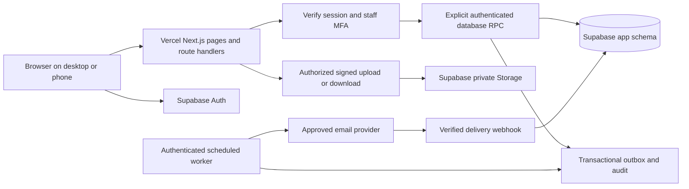

# Supabase and Vercel architecture

## Selected stack
Use a new Next.js App Router application with React and TypeScript on Vercel, Supabase Auth, PostgreSQL and private Storage, and a college-approved transactional email provider. Use the current compatible stable versions at implementation time and commit one package-manager lockfile. This makes the earlier general React proposal concrete; no existing application is being migrated. Do not copy Crossfire secrets or reuse its database.

Place the future app in `C:/Fire&Flames/app`. Preserve `planning`, `handoff` and the original documents. Keep a single application instead of starting a monorepo without a need. Suggested layout:

```text
app/
  src/app/(public)/e-fest/   src/app/(public)/esports/
  src/app/(auth)/           src/app/(student)/dashboard/
  src/app/(staff)/teacher/  src/app/(staff)/volunteer/
  src/app/(staff)/judge/    src/app/(staff)/admin/
  src/app/(staff)/super-admin/  src/app/api/
  src/features/  src/components/  src/domain/  src/lib/supabase/
  public/brand/  public/images/
  supabase/migrations/  supabase/tests/  tests/e2e/
  .env.example  package.json  lockfile  vercel.json
```

## Request and trust boundaries


Authentication is managed by Supabase. Use the documented `@supabase/ssr` cookie flow and verify identity server-side with a supported verified-user/claims call; do not trust a browser-provided user ID or an unverified session object. Choose the cookie options supported by the chosen SSR flow; do not claim tokens are HttpOnly if the browser auth client actually requires access. CSRF/Origin checks apply to cookie-authenticated writes. Protect authorization at each command, not only middleware/proxy.

The `app` database schema contains all domain tables and is not an exposed Data API schema. Enable RLS on every domain table. Baseline grants intentionally permit neither anon nor authenticated table access. Add narrow, reviewed `public.rpc_*` functions only as each feature is implemented. Each function uses `auth.uid()`, current database assignments, event/organizer scope, `aal2` for staff, fixed empty search_path and qualified names. Revoke default PUBLIC execution and grant only the necessary roles. A SECURITY DEFINER function bypassing owner RLS is a privileged boundary and must validate everything itself.

Browser requests go through route handlers for normal application workflows, forwarding the user's verified access context to RPCs. Do not use a service-role client as a substitute for the user's permissions. Provisioning staff and narrowly bounded worker operations may require a server-only elevated client; put them in isolated modules with separate caller authorization and audit. Never accept an `actor_id` supplied by the browser as the audit identity.

Public reads use safe projection RPCs with published fields only. Never grant public access to entire event-version rows if they contain internal configuration. Private pages/API responses use no-store semantics and must not enter shared/CDN caches. Supabase Realtime is optional: use it only for own notifications or a purpose-built authorized channel, not broad participant/payment subscriptions. Initial release can poll small scoped endpoints.

## Payment and competition model
A registration is a payable enrollment; a competition entry is the team/stall/project that competes. They are separate. One ₹99 team registration can fund several consenting members in one entry. Several separately paid ₹59 individual registrations may join one competition entry only after the college approves that policy. Each retains its own order and credit record. No additional ₹99 is silently created. `entry_participants` links an entry to accepted registration members and enforces event/identity consistency.

A waitlist/reservation belongs to a competition entry because capacity is normally team/stall/entry capacity. For individual intake, allocate a complete provisional team and obtain consent before creating its payable reservations/orders. This refines the earlier plan to avoid collecting solo fees against capacity that cannot be guaranteed. If the college insists on paying before allocation, record a new approved ADR and implement explicit paid-unallocated/refund handling before enabling it. Do not invent a solo capacity conversion or charge unallocated people.

Participant passes link to entry_participants. Payment verification alone does not issue passes: each member's registration must be paid, its membership accepted, and the whole entry meet the approved roster/funding policy. The default is that an entry is confirmed only when every active member's registration is funded. A mixed paid/unpaid pooled team stays held and escalates near expiry.

## Background work and delivery
Use transactional outbox records, leased jobs, bounded attempts, exponential retry and deduplication. Vercel scheduled functions may trigger the worker only at a frequency supported by the actual plan. Do not promise minute-level email delivery on a daily-only schedule. For a faster approved cadence, use Supabase Cron or another supported managed worker with a recorded decision. No permanent in-memory timer in a Vercel function.

Store only provider-accepted/delivered states actually observed. Verify webhook signatures and deduplicate provider event IDs. Do not leave work running after a serverless response unless using a documented supported lifecycle mechanism; durable jobs survive interruption.

## Environments and recovery
Use separate Supabase projects for staging and production and separate Vercel environment variables. Preview deployments must not point to production or send real participant notifications. Link each deployment to a Git commit, database migration list and environment. Use forward-only schema migrations; a Vercel rollback does not undo database changes. Measure restore RPO/RTO against the selected Supabase plan and rehearse in staging.

## Primary references checked
- Supabase SSR: https://supabase.com/docs/guides/auth/server-side
- Supabase database functions: https://supabase.com/docs/guides/database/functions
- Supabase RLS: https://supabase.com/docs/guides/database/postgres/row-level-security
- Vercel scheduled jobs: https://vercel.com/docs/cron-jobs/manage-cron-jobs

These links explain the product capabilities behind the design. They do not establish that this project's runtime or integrations have been tested.
