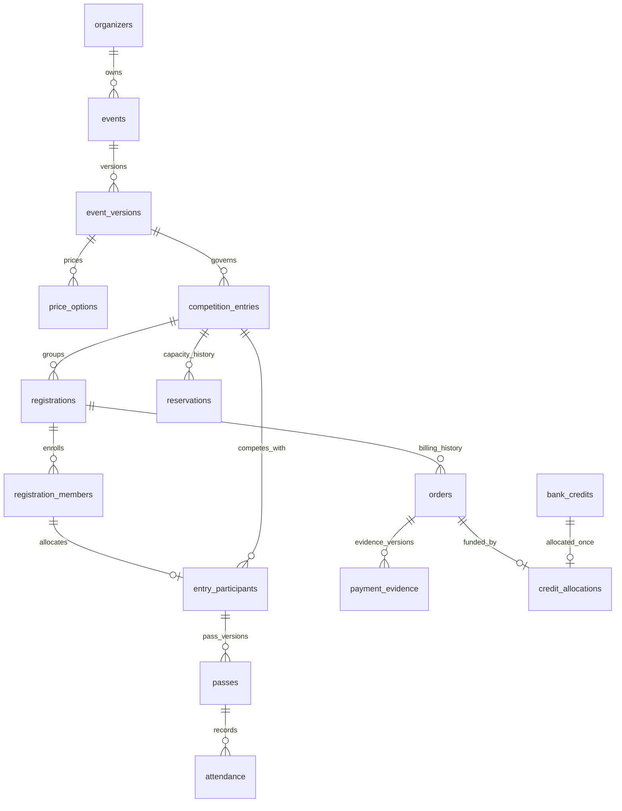
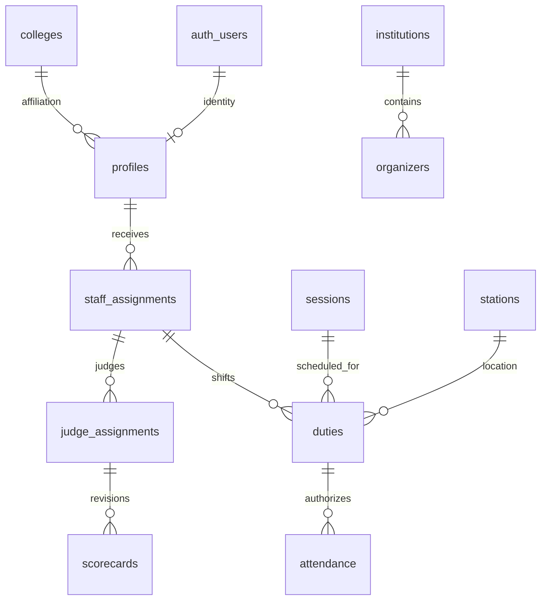
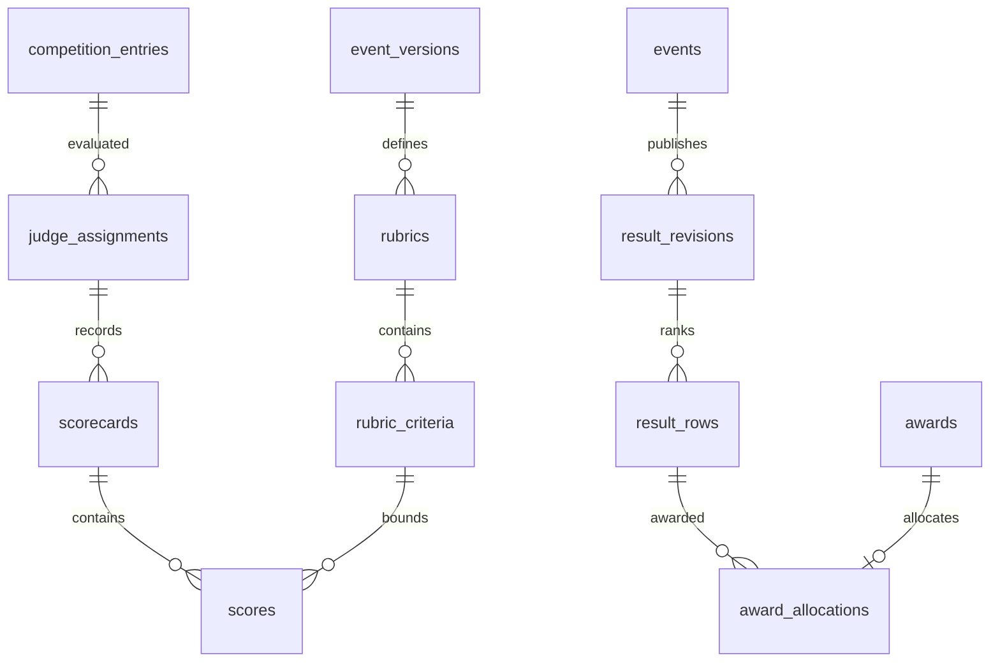

# Database model and relationships

## Core registration graph

Registration is a billing/consent entity. Competition entry is the team/stall/project judged as a unit. An individual registration holds one accepted member and may be grouped with other individually funded registrations into a pooled entry. A team registration holds its consenting members and funds them once. There is no separate mutable team roster competing with the registration/entry model: `registration_members` owns consent and `entry_participants` owns current competitive allocation.

Changing members within the same entry is an explicit administrative command with consent, snapshot revision, audit and pass revocation/reissue. Mark the old registration member removed and entry participant inactive, retain historical records, add the replacement with accepted consent and issue a new pass only after eligibility checks. The composite FK intentionally prevents moving a funded registration to another competition entry casually. In v1, moving between entries after payment is prohibited; use a documented cancellation/refund and fresh registration instead. Before any payment/order/pass/attendance exists, the allocation command may replace provisional associations transactionally. Never delete historical attendance to make a transfer work.

## Identity and staff graph

Affiliation is descriptive; only staff_assignments grants privileges. Null organizer/event on a super-admin assignment means institution scope; null event on an event-admin/finance/export assignment means organizer-wide scope. Teacher, volunteer and judge assignments require an event. Each function verifies that any linked duty/judge assignment matches the correct role and scope; a foreign key alone does not prove permission or an active shift.

## Financial graph
Payment profiles are institution-owned, versioned college destinations shared across organizers. The event's institution must match the order's payment profile in the reserve command. A changed QR creates a new profile, never silently updates an active one. Two-person control means one named super admin proposes the checked destination and another named super admin independently approves activation. `payment_profile_approvals` stores the independent decision; the approver cannot equal proposed_by. This requires two people, not three accounts.

Bank credits have receiving-account plus settled-transaction uniqueness independent of displayed UTR. The initial rule is exact payment to one order. Match profile version/account, amount and evidence before allocation. If the receiving account is unchanged across QR versions, route the bank import to the actual order's payment-profile version after matching; do not create duplicate bank credit records for the same transaction. Over/underpayments are exceptions, not automatic partial allocations. Refunds retain their own transfer reference and cumulative cap under an order lock.

## Scoring and publication graph

Scorecards are per judge, candidate entry and rubric with revisions. Locked cards are immutable in the workflow; reopening creates a new draft revision after superseding the old one, with a reason. The trigger protects score edits/deletes, while commands must protect scorecard state and rubric configuration. Result totals reference the exact locked scorecard revision IDs and tie decisions. Supersede published results instead of overwriting them. Prize disbursement is separate from leaderboard publication; a corrected leaderboard never automatically moves an already-disbursed prize.

## Event specific and infrastructure domains
Treasure Hunt uses checkpoints and checkpoint_completions for entry-level ordered progress; duplicate checkpoint completion is rejected. Scoring/timing penalties and corrections need audited commands. Esports uses player_profiles, matches and match_entries; approved formulas determine points, never defaults inferred from typical game rules. Bazar popularity uses verified poll_evidence from the official Instagram poll.

Files stores private object metadata, scan status and retention, not file bodies. Notifications stores durable own-user messages; outbox drives delivery; delivery and webhook tables track what the provider actually reports. Idempotency_records deduplicates commands by actor/command/key plus payload hash. Audit is append-only. Incident/export/decision tables support operations without exposing private records publicly.

## Constraints versus command enforcement
SQL CHECK constraints do not reliably enforce cross-row policy such as total refunds, roster size or the number of approvals. Unique/FK/check constraints are the final structural safety net. The command transaction is responsible for business transitions, fresh authority, locking and notification/audit atomicity. Antigravity must not confuse an insert succeeding as database owner in a fixture with permission for a real user to perform it.
