# Complete database relationships

Generated from actual foreign keys. An edge means one parent can have many children; unique keys may further restrict cardinality. Optional links are defined in the dictionary. The diagram does not imply cascade deletion.

```mermaid
erDiagram
  app_duties ||--o{ app_attendance : references
  app_passes ||--o{ app_attendance : references
  app_profiles ||--o{ app_audit_log : references
  app_events ||--o{ app_audit_log : references
  app_institutions ||--o{ app_audit_log : references
  app_organizers ||--o{ app_audit_log : references
  app_profiles ||--o{ app_award_allocations : references
  app_awards ||--o{ app_award_allocations : references
  app_result_rows ||--o{ app_award_allocations : references
  app_event_versions ||--o{ app_awards : references
  app_payment_profiles ||--o{ app_bank_credits : references
  app_profiles ||--o{ app_bank_credits : references
  app_profiles ||--o{ app_broadcasts : references
  app_events ||--o{ app_broadcasts : references
  app_organizers ||--o{ app_broadcasts : references
  app_checkpoints ||--o{ app_checkpoint_completions : references
  app_duties ||--o{ app_checkpoint_completions : references
  app_competition_entries ||--o{ app_checkpoint_completions : references
  app_events ||--o{ app_checkpoints : references
  app_stations ||--o{ app_checkpoints : references
  app_profiles ||--o{ app_competition_entries : references
  app_event_versions ||--o{ app_competition_entries : references
  app_profiles ||--o{ app_credit_allocations : references
  app_bank_credits ||--o{ app_credit_allocations : references
  app_orders ||--o{ app_credit_allocations : references
  app_profiles ||--o{ app_decision_records : references
  app_institutions ||--o{ app_decision_records : references
  app_sessions ||--o{ app_duties : references
  app_staff_assignments ||--o{ app_duties : references
  app_stations ||--o{ app_duties : references
  app_registration_members ||--o{ app_entry_participants : references
  app_registrations ||--o{ app_entry_participants : references
  app_competition_entries ||--o{ app_esports_match_entries : references
  app_esports_matches ||--o{ app_esports_match_entries : references
  app_profiles ||--o{ app_esports_match_entries : references
  app_esports_matches ||--o{ app_esports_match_result_revisions : references
  app_profiles ||--o{ app_esports_match_result_revisions : references
  app_esports_scoring_versions ||--o{ app_esports_match_result_revisions : references
  app_events ||--o{ app_esports_matches : references
  app_event_versions ||--o{ app_esports_matches : references
  app_sessions ||--o{ app_esports_matches : references
  app_esports_scoring_versions ||--o{ app_esports_placement_points : references
  app_competition_entries ||--o{ app_esports_roster_members : references
  app_profiles ||--o{ app_esports_roster_members : references
  app_esports_rosters ||--o{ app_esports_roster_members : references
  app_competition_entries ||--o{ app_esports_rosters : references
  app_profiles ||--o{ app_esports_rosters : references
  app_registrations ||--o{ app_esports_rosters : references
  app_event_versions ||--o{ app_esports_rules_versions : references
  app_profiles ||--o{ app_esports_scoring_versions : references
  app_events ||--o{ app_esports_scoring_versions : references
  app_event_versions ||--o{ app_esports_scoring_versions : references
  app_profiles ||--o{ app_event_versions : references
  app_events ||--o{ app_event_versions : references
  app_organizers ||--o{ app_events : references
  app_event_versions ||--o{ app_events : references
  app_events ||--o{ app_export_jobs : references
  app_files ||--o{ app_export_jobs : references
  app_organizers ||--o{ app_export_jobs : references
  app_profiles ||--o{ app_export_jobs : references
  app_organizers ||--o{ app_files : references
  app_profiles ||--o{ app_files : references
  app_profiles ||--o{ app_idempotency_records : references
  app_events ||--o{ app_identity_verifications : references
  app_files ||--o{ app_identity_verifications : references
  app_profiles ||--o{ app_identity_verifications : references
  app_profiles ||--o{ app_incidents : references
  app_events ||--o{ app_incidents : references
  app_organizers ||--o{ app_incidents : references
  app_competition_entries ||--o{ app_judge_assignments : references
  app_rubrics ||--o{ app_judge_assignments : references
  app_staff_assignments ||--o{ app_judge_assignments : references
  app_profiles ||--o{ app_match_substitute_activations : references
  app_competition_entries ||--o{ app_match_substitute_activations : references
  app_esports_matches ||--o{ app_match_substitute_activations : references
  app_esports_roster_members ||--o{ app_match_substitute_activations : references
  app_competition_entries ||--o{ app_match_technical_logs : references
  app_esports_matches ||--o{ app_match_technical_logs : references
  app_profiles ||--o{ app_match_technical_logs : references
  app_outbox ||--o{ app_notification_deliveries : references
  app_events ||--o{ app_notifications : references
  app_profiles ||--o{ app_notifications : references
  app_payment_profiles ||--o{ app_orders : references
  app_registrations ||--o{ app_orders : references
  app_reservations ||--o{ app_orders : references
  app_institutions ||--o{ app_organizers : references
  app_profiles ||--o{ app_outbox : references
  app_entry_participants ||--o{ app_passes : references
  app_orders ||--o{ app_payment_evidence : references
  app_files ||--o{ app_payment_evidence : references
  app_profiles ||--o{ app_payment_evidence : references
  app_profiles ||--o{ app_payment_exceptions : references
  app_orders ||--o{ app_payment_exceptions : references
  app_profiles ||--o{ app_payment_profile_approvals : references
  app_payment_profiles ||--o{ app_payment_profile_approvals : references
  app_institutions ||--o{ app_payment_profiles : references
  app_profiles ||--o{ app_payment_profiles : references
  app_files ||--o{ app_payment_profiles : references
  app_bank_credits ||--o{ app_payment_reviews : references
  app_payment_evidence ||--o{ app_payment_reviews : references
  app_profiles ||--o{ app_payment_reviews : references
  app_profiles ||--o{ app_player_profiles : references
  app_awards ||--o{ app_poll_evidence : references
  app_events ||--o{ app_poll_evidence : references
  app_files ||--o{ app_poll_evidence : references
  app_profiles ||--o{ app_poll_evidence : references
  app_competition_entries ||--o{ app_poll_evidence : references
  app_event_versions ||--o{ app_price_options : references
  app_colleges ||--o{ app_profiles : references
  auth_users ||--o{ app_profiles : references
  app_profiles ||--o{ app_refunds : references
  app_orders ||--o{ app_refunds : references
  app_profiles ||--o{ app_registration_members : references
  app_registrations ||--o{ app_registration_members : references
  app_event_versions ||--o{ app_registration_members : references
  app_competition_entries ||--o{ app_registrations : references
  app_profiles ||--o{ app_registrations : references
  app_price_options ||--o{ app_registrations : references
  app_competition_entries ||--o{ app_reservations : references
  app_profiles ||--o{ app_result_revisions : references
  app_events ||--o{ app_result_revisions : references
  app_competition_entries ||--o{ app_result_rows : references
  app_result_revisions ||--o{ app_result_rows : references
  app_rubrics ||--o{ app_rubric_criteria : references
  app_event_versions ||--o{ app_rubrics : references
  app_judge_assignments ||--o{ app_scorecards : references
  app_profiles ||--o{ app_scorecards : references
  app_rubric_criteria ||--o{ app_scores : references
  app_scorecards ||--o{ app_scores : references
  app_events ||--o{ app_sessions : references
  app_venues ||--o{ app_sessions : references
  app_events ||--o{ app_staff_assignments : references
  app_profiles ||--o{ app_staff_assignments : references
  app_institutions ||--o{ app_staff_assignments : references
  app_organizers ||--o{ app_staff_assignments : references
  app_events ||--o{ app_station_hardware_checks : references
  app_profiles ||--o{ app_station_hardware_checks : references
  app_sessions ||--o{ app_station_hardware_checks : references
  app_stations ||--o{ app_station_hardware_checks : references
  app_events ||--o{ app_stations : references
  app_venues ||--o{ app_stations : references
  app_events ||--o{ app_team_declarations : references
  app_profiles ||--o{ app_team_declarations : references
  app_registrations ||--o{ app_team_declarations : references
  app_event_versions ||--o{ app_team_declarations : references
  app_profiles ||--o{ app_team_invitations : references
  app_registrations ||--o{ app_team_invitations : references
  app_institutions ||--o{ app_venues : references
  app_profiles ||--o{ app_verification_requests : references
  app_competition_entries ||--o{ app_waitlist_entries : references
```

For implementation, use the domain diagrams in DATABASE_MODEL.md and the exact composite foreign keys in 001_schema_design.sql and 002_esports_lan_extensions.sql.
